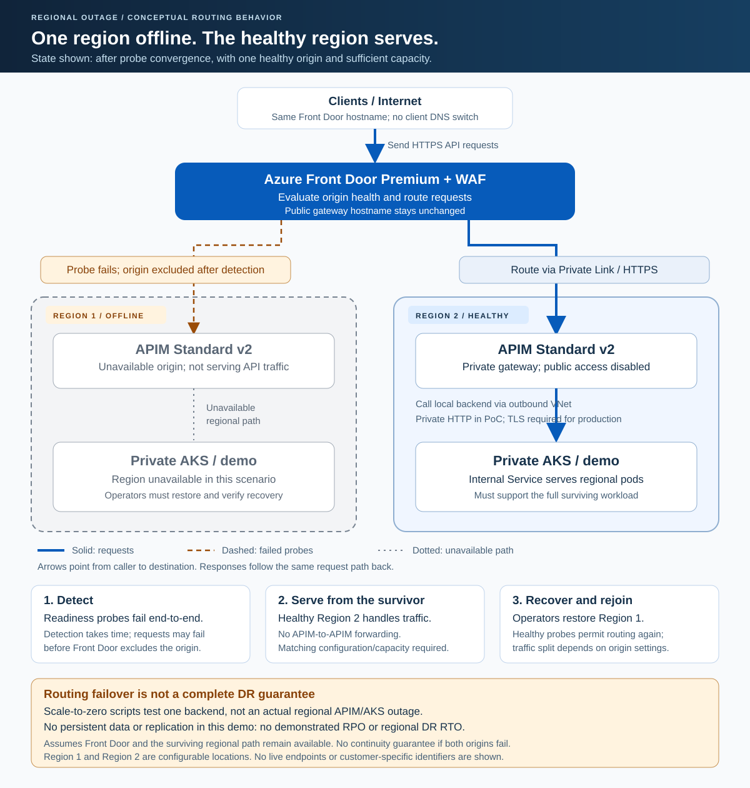

# apim-multi-region

Azure Front Door Premium and WAF route public HTTPS traffic through Private Link
to two independent APIM Standard v2 gateways, each backed by a private AKS cluster.
The project uses Azure Developer CLI (`azd`) and Bicep.

**Start here:** [complete script guide](./scripts/README.md) |
[PowerShell scripts](./scripts/ps1/) | [native Bash scripts](./scripts/bash/) |
[local tests](./tests/).

```text
Internet -> Front Door Premium + WAF
               |                    |
          Private Link         Private Link
               |                    |
         APIM Standard v2     APIM Standard v2
           Region 1               Region 2
               |                    |
          Outbound VNet         Outbound VNet
               |                    |
          Private AKS           Private AKS
         Regional demo        Regional demo
```

There is no APIM Developer gateway, VM proxy, or intermediary load balancer before
APIM. The Kubernetes Service uses an internal load balancer **after** APIM.

### Architecture diagram


[Open the architecture SVG](./docs/arquitetura/arquitetura-alternativa-2-privada.svg).
This conceptual reference uses Brazil South/East US and shows the production
target, including private backend HTTPS and data dependencies. The implemented
PoC instead uses private backend HTTP, synthetic unauthenticated responses, and
no database or replication. Actual regions are configurable, as described below.

## Regions and sample scope

The original [architecture alternative 2](./docs/arquitetura/arquitetura-alternativa-2-apim-standard-v2-privado.md)
describes Brazil South/East US. Regions are configurable; the setup examples use
West US 2/East US as an alternative. Select locations supported by your subscription
and confirm service/SKU availability before deployment. This sample does not
certify data residency, regulatory compliance, or a production SLA.

Legacy names `br`, `BRAZIL_*`, and `BrazilLocation` identify the first regional
resource set, not necessarily Brazil. Neutral aliases `region1`, `region2`,
`Region1Location`, and `Region2Location` are available without renaming resources.
The selected azd environment supplies the actual locations.

There is **no hosted demo endpoint** provided by this repository. After your own
approved deployment, read `API_URL` and `API_HEALTH_URL` using
`azd env get-values --output json`. Endpoint shape:
`https://<generated-hostname>.azurefd.net/demo/`.

Local tests use synthetic inputs and mocked Azure operations. They do not prove
the current health of any deployment, regional outage recovery, or production
readiness. Deploying the sample creates billable Azure resources.

### PoC-only concessions

- Client -> Front Door -> APIM uses HTTPS. APIM -> internal AKS Service uses
  **private HTTP**. Production requires trusted backend TLS, without disabling
  certificate validation.
- The demo has no consumer authentication and returns synthetic region/health
  information only. Add authentication before handling real data.
- The default profile uses two pods and two nodes per region, AKS Free tier,
  and no explicit node zones. It does not establish a production SLA.
- There is no database, queue, data replication, or demonstrated RPO.
- AKS Run Command is a lab bootstrap convenience. Production delivery should use
  private agents with cluster access.
- AKS has public **outbound** connectivity for dependencies/images. This is not
  an internet-isolated network.
- APIM Private Endpoint protects gateway ingress, not automatically its portal,
  Azure Resource Manager, or every management endpoint.

APIM Developer cannot preserve this topology: classic-tier VNet injection needed
for private backend access cannot be combined with its inbound Private Endpoint.
Standard v2 supports inbound Private Link plus outbound VNet integration.

## Repository map

| Location | Purpose |
|---|---|
| [azure.yaml](./azure.yaml) | Infrastructure project and OS-specific azd hooks. |
| [infra/main.bicep](./infra/main.bicep) | Subscription-scope orchestration of three resource groups. |
| [infra/modules/region.bicep](./infra/modules/region.bicep) | Regional network, identity, private AKS, APIM, and diagnostics. |
| [infra/modules/front-door.bicep](./infra/modules/front-door.bicep) | Global Front Door Premium, Private Link, WAF, and diagnostics. |
| [infra/gateway.bicep](./infra/gateway.bicep) | Demo APIs/policies, published after both gateways are private. |
| [scripts/README.md](./scripts/README.md) | Every script, parameters, dependencies, effects, and recovery. |
| [scripts/ps1/](./scripts/ps1/) / [scripts/bash/](./scripts/bash/) | Equivalent PowerShell and native Bash operational paths. |
| [scripts/toolchain.json](./scripts/toolchain.json) | Pinned CI tool versions shared by both shells. |
| [k8s/demo.yaml](./k8s/demo.yaml) | Manifest template; do not apply without rendering placeholders. |
| [src/demo/server.py](./src/demo/server.py) | Standard-library HTTP API, health endpoints, and JSON logs. |
| [src/demo/Dockerfile](./src/demo/Dockerfile) | Optional immutable application image. |
| [tests/](./tests/) | Application, script, bootstrap, failover, manifest, and ARM checks. |

## 1. Prerequisites

Choose a shell; **native Bash operations do not require PowerShell**.

| Use | Requirements |
|---|---|
| PowerShell operations | PowerShell 7, Azure CLI, azd, Bicep CLI on `PATH`. |
| Bash operations | Bash 4+, `jq`, `python3` 3.10+, `curl`, Azure CLI, azd, Bicep CLI. |
| Local tests | Python 3.10+ and [requirements-test.txt](./requirements-test.txt); Bicep. PowerShell suite also needs `pwsh`. |
| CI | Versions in [toolchain.json](./scripts/toolchain.json); Linux native Bash and Windows PowerShell jobs. |

Use Linux, WSL, or an appropriately configured Git Bash for Bash. The macOS
system Bash 3.2 is too old; install a current Bash. Run az/azd authentication and
environment selection in the **same host environment** as the scripts. Windows
and WSL tool installations/authentication stores may differ.

For deployment, also provide:

- `az login` and `azd auth login`.
- Subscription permissions to create resources and assign network/identity RBAC.
- APIM Private Endpoint approval and public-access update permissions.
- AKS `runcommand/action` and `commandResults/read` permissions.
- The object ID of a real **Entra security group** for AKS administration, plus
  Microsoft Graph access to read that group.
- Registered providers: Microsoft.ApiManagement, Microsoft.Cdn, Microsoft.Network,
  Microsoft.ContainerService, Microsoft.Compute, Microsoft.ManagedIdentity,
  Microsoft.OperationalInsights, and Microsoft.Insights.
- Regional Standard v2 availability, Front Door Premium Private Link support,
  and capacity for four `Standard_D2s_v4` VMs in the default two-cluster setup.
- Node egress to `docker.io/library/python:3.13-alpine` in ConfigMap mode, or to
  the approved image registry when `DEMO_IMAGE` is configured.

Scripts do not silently register providers or change the global Azure CLI
subscription. Available vCPU quota does not eliminate SKU/subscription restrictions.

## 2. Initialize the local environment

Run examples from the repository root. Replace placeholders with real values.
These commands configure local azd settings; they do not provision resources.
They do query the selected subscription to verify its tenant.

**PowerShell**

```powershell
.\scripts\ps1\Initialize-Environment.ps1 `
  -SubscriptionId "<subscription-guid>" -TenantId "<tenant-guid>" `
  -PublisherEmail "<publisher-email>" -PublisherName "Private multi-region PoC" `
  -AksAdminGroupObjectId "<entra-security-group-object-id>" `
  -Region1Location westus2 -Region2Location eastus `
  -EnvironmentName poc-apim-private
```

**Bash**

```bash
bash scripts/bash/initialize-environment.sh \
  --subscription-id "<subscription-guid>" --tenant-id "<tenant-guid>" \
  --publisher-email "<publisher-email>" --publisher-name "Private multi-region PoC" \
  --aks-admin-group-object-id "<entra-security-group-object-id>" \
  --region1-location westus2 --region2-location eastus \
  --environment-name poc-apim-private
```

Defaults remain `brazilsouth` and `eastus`; the examples explicitly select the
alternative sample locations. Confirm region/SKU availability before provisioning.
Local environment values are ignored by version control. To complete an older
environment: `azd env set AKS_ADMIN_GROUP_OBJECT_ID "<real-group-object-id>"`.
Missing or fictitious group IDs stop preflight.

## 3. Validate locally, without Azure access

**PowerShell: full PowerShell/ARM suite plus Python tests**

```powershell
python -m pip install -r .\requirements-test.txt
.\scripts\ps1\Invoke-Validation.ps1
# Also require pinned Python/PowerShell/Bicep and actionlint:
.\scripts\ps1\Invoke-Validation.ps1 -RequirePinnedTools
```

**Bash: native tests, rendered manifests, and Bicep compilation**

```bash
python3 -m pip install -r requirements-test.txt
bash scripts/bash/invoke-validation.sh
# On a runner with the pinned Python/Bicep and actionlint:
bash scripts/bash/invoke-validation.sh --require-pinned-tools
```

For one suite, use the commands in the [test reference](./scripts/README.md#local-test-scripts).
The mandatory Linux CI job fails rather than skipping missing Bash dependencies.
Windows local runs may explicitly skip native tests if Bash/jq/python3 are absent.

Tests cover bootstrap rejection/disconnection/timeouts, ambiguous or unexpected
connections, wrong origins, privacy gates, partial publication/resume, malformed
CIDRs/images, HTTP failures, failover convergence, and restoration/report failures.
They use mocks, not deployed resources. Native and PowerShell coverage are
complementary: compiled ARM contract assertions additionally run in PowerShell.
Compilation alone does not prove Azure quota, permissions, policy, regional
availability, connectivity, or Front Door convergence.

## 4. Provision only after approval

**These commands create billable resources.**

```text
azd provision
```

`azd up` is also supported. The demo is installed by `postprovision`; there is no
application `services` entry and no need for `azd deploy`.
[azure.yaml](./azure.yaml) automatically uses PowerShell hooks on Windows and
native Bash hooks on POSIX. Select the intended environment before either path.

### Bootstrap order and privacy gate

1. Preflight validates configuration, subscription, admin group, and providers.
2. Existing APIM gateways with public access disabled remain disabled on reprovision.
3. Bicep creates networking, clusters, gateways, Front Door, WAF, and origin requests.
4. Bootstrap finds the requests matching this environment/profile marker, approves
   only one correlated request per origin, and rejects ambiguity/unexpected approvals.
5. It verifies APIM approval and Front Door origin resource/group/marker correlation.
6. It disables and verifies public gateway access on **both** APIMs.
7. Only then does it deploy the workloads and publish `/demo/` APIs.
8. Allow Front Door configuration and health probes to converge before end-to-end testing.

APIM needs a Private Endpoint before public access can be disabled. Initial
creation therefore has a public gateway bootstrap phase, **without the demo API**.
Do not treat provisioning as complete until the post hook succeeds.

Approval comes from APIM's connection state, not the sometimes-null Front Door
`sharedPrivateLinkResource.status`. The marker is operational correlation, not
cryptographic requester authentication. Review unexpected requests manually.
Standard v2 public-access updates use ARM API `2024-05-01`.

The internal Service restricts sources to the APIM integration subnet.
`X-Azure-FDID` validation is defense in depth, not a replacement for disabled
public gateway access.

After correcting a failed post-bootstrap operation, resume with:

```text
azd hooks run postprovision
```

This changes live resources. It preserves privacy and reapplies workloads/APIs.
Do not edit connection markers or run parallel provisioning/failover operations.

## 5. Verify the deployed environment

These are **live, read-only configuration checks plus HTTP requests**, not local tests:

```powershell
.\scripts\ps1\Test-EndToEnd.ps1 -Samples 10
```

```bash
bash scripts/bash/test-end-to-end.sh --samples 10
```

They verify private AKS/admin settings, disabled APIM public access, explicit
direct-access denial even with the correct FDID, Front Door HTTP 200 responses,
matching JSON/header regions, correlation GUIDs, and readiness.
A generic 403/404 is not accepted as proof of network isolation.

Read `API_URL` and `API_HEALTH_URL` from `azd env get-values --output json`.
Never execute/evaluate its output as shell code. A typical response is:

```json
{
  "service": "regional-demo",
  "message": "Private AKS through APIM and Front Door",
  "region": "westus2"
}
```

`X-Served-Region` must match the JSON region. Readiness returns
`{"status":"ok","region":"westus2"}` or the other configured location.
Equal weights do not guarantee a 50/50 split or that one client sees both regions.

## 6. Exercise backend failover safely

### When one region is unavailable



[Open the regional failover SVG](./docs/arquitetura/regional-failover.svg).
The diagram shows Region 1 unavailable; the same routing principle applies if
Region 2 fails instead. Clients continue using the same Front Door hostname:
there is no client DNS change and no APIM-to-APIM forwarding.

1. **Detect:** end-to-end readiness probes fail for the affected origin.
2. **Converge:** after the configured health evaluation, Front Door excludes
   that origin while the other origin remains healthy. Requests can fail during
   detection/convergence; failover is not instantaneous.
3. **Serve:** the surviving regional APIM and AKS handle the traffic. They must
   already have working private connectivity, matching APIs/images, healthy
   dependencies, and sufficient capacity; traffic failover does not create capacity.
4. **Recover:** operators restore and verify the failed region. Front Door can
   use its origin again once probes mark it healthy; traffic distribution still
   depends on origin settings and latency, not a guaranteed 50/50 split.

This is a **conceptual regional-outage flow, not evidence of tested regional DR**.
The scripts below simulate only backend unavailability by scaling one demo
deployment to zero; they do not stop an Azure region, its APIM, or its cluster.
The demo has no persistent data, so neither the diagram nor the exercise proves
replication, RPO, or a DR RTO. If both origins are unhealthy, Front Door behavior
does not guarantee continuity or an absolute traffic block.

### Run the controlled backend exercise

**This interrupts one application. It is not a full regional disaster-recovery test.**
Use an approved maintenance window, confirm survivor capacity, and keep an
operator able to restore replicas. Do not run competing operators/pipelines.

First preview; no environment read or Azure access occurs:

```powershell
.\scripts\ps1\Test-Failover.ps1 -Region region1 -AllowDisruption -WhatIf
```

```bash
bash scripts/bash/test-failover.sh --region region1 --allow-disruption --what-if
```

Only after explicit authorization, run **one** shell's exercise:

```powershell
.\scripts\ps1\Test-Failover.ps1 -Region region1 -AllowDisruption `
  -TimeoutSeconds 300 -ConsecutiveSuccesses 5 `
  -OutputPath .\TestResults\failover-region1.json
```

```bash
bash scripts/bash/test-failover.sh --region region1 --allow-disruption \
  --timeout-seconds 300 --consecutive-successes 5 \
  --output-path TestResults/failover-region1.json
```

PowerShell prompts through `ShouldProcess`; Bash requires typing `YES`.
Noninteractive overrides are documented in the [script guide](./scripts/README.md#test-failover):
do not use them merely to bypass approval.

The runner checks both deployments and a healthy baseline, scales only the target
to zero, waits for its pods to disappear, then samples the surviving region.
It attempts to restore the **original** replica count and verifies deployment/API
recovery. Reports contain samples, errors, p95 latency, fault-command duration,
and observed convergence. Inspect both `Passed` and `Restored`.

HTTP sampling starts **after** the fault command finishes. Observed convergence
includes that command interval and the required success streak; it is not exact
outage duration or a demonstrated DR RTO. There is no RPO measurement.
Process/host failure or unavailable Azure control plane can prevent restoration.

For manual 0/2-replica toggles, use the [availability script](./scripts/README.md#set-demo-availability).
It has **no automatic restoration** and does not preserve a custom original count.

## 7. CI and approved immutable releases

- [Validate](./.github/workflows/validate.yml): PR/push/manual/reusable validation;
  Windows PowerShell/ARM checks, a mandatory Ubuntu native-Bash job, and an Ubuntu
  container build/smoke test. The container job uses read-only permissions, never
  logs into a registry or publishes an image, and tests non-root/read-only execution.
  PR checks run without Azure credentials.
- [Release immutable image](./.github/workflows/release-image.yml): manual,
  validation-gated build; resolves the base digest, scans HIGH/CRITICAL
  vulnerabilities, smoke-tests non-root/read-only execution, then publishes GHCR.
  The `release-image` artifact contains the full digest reference.
- [Deploy approved PoC](./.github/workflows/deploy.yml): manual, validation-gated,
  OIDC deployment of an approved image using existing hooks and a final live check.
  Runs targeting the same azd environment are serialized; a newer run does not
  cancel an in-progress provisioning operation. GitHub may replace an older
  pending run with a newer pending run; this is not a FIFO deployment queue.
  Local/manual operations outside this workflow still require coordination.
  **Not a production pipeline.**

External GitHub Actions are pinned to full commit SHAs. Weekly
[Dependabot updates](./.github/dependabot.yml) propose GitHub Actions and Python
test dependency updates; review them and let required checks run before merging.
Tool versions in [toolchain.json](./scripts/toolchain.json) and Bicep module
versions still require coordinated manual updates.

[CODEOWNERS](./.github/CODEOWNERS) assigns every path to `@seilorjunior`, including
workflow and ownership changes. The main-branch ruleset must require code-owner
approval and the `local`, `native-bash`, and `container` checks. Keep owner-only
bypass configured separately in GitHub; this file does not grant bypass access.
GitHub authors cannot approve their own PRs, so owner-authored changes need
another eligible owner or an explicit use of the owner's bypass.

Before enabling release/deployment:

1. Configure GitHub environments `image-release` and `azure-deployment` with
   required reviewers, prevention of self-approval, and release-branch restrictions.
   Workflows fail if required reviewers are missing; these protections are external
   to YAML and depend on the GitHub plan.
2. Set deployment environment variables `AZURE_CLIENT_ID`, `AZURE_TENANT_ID`,
   `AZURE_SUBSCRIPTION_ID`, `APIM_PUBLISHER_EMAIL`, `AKS_ADMIN_GROUP_OBJECT_ID`,
   `REGION1_LOCATION`, and `REGION2_LOCATION`. Preserve actual existing locations.
3. Configure Entra federation for
   `repo:<owner>/<repo>:environment:azure-deployment` and required ARM/RBAC/Graph
   permissions. Do not introduce client secrets.
4. Make the approved GHCR package public, or implement authenticated pulls first.
   The PoC does not create `imagePullSecrets`; private packages will fail rollout.
5. Review the image and costs before approving deployment. No workflow
   automatically performs failover or resource deletion.

Configure an approved image with
`azd env set DEMO_IMAGE "ghcr.io/<owner>/<repo>@sha256:<64-lowercase-hex-digest>"`.
Both regions use the same digest. This mode removes source ConfigMap/mounts and
uses the image command. Without `DEMO_IMAGE`, legacy ConfigMap mode remains.
Rollback means selecting a previous approved digest and rerunning the post hook
**after deployment approval**.

## 8. Opt-in observability and availability profile

The API writes structured JSON logs without query strings: region, path, status,
duration, and request ID. APIM replaces `X-Correlation-ID` with `context.RequestId`,
passes it to the backend, and returns it, including policy errors.

Settings take effect only when provisioning again with authorization:

| azd setting | Default | Opt-in behavior |
|---|---|---|
| `MONITORING_MODE` | `Disabled` | Dedicated APIM GatewayLogs and Container Insights workload collection. |
| `ALERTS_MODE` | `Disabled` | Regional/global alerts; requires monitoring and an existing action group. |
| `ALERT_ACTION_GROUP_ID` | `none` | Resource ID of an existing, configured notification action group. |
| `DEPLOYMENT_PROFILE` | `poc` | `production`: candidate infrastructure with AKS Standard, at least three nodes, and explicit zones. |
| `REGION1_ZONES`, `REGION2_ZONES` | `none` | Two or three distinct supported zones per region, for example `1,2,3`. |

Preflight initializes missing settings in older environments **without enabling
new costs**. The production candidate requires an immutable image, monitoring,
and routed alerts. Use a new environment or an existing matching Standard/zonal
cluster. Automatic migration of non-zonal clusters is blocked; plan node-pool
migration separately. Confirm regional SKU, capacity, and zone support externally.

Pods require distribution across hosts and prefer distribution across zones.
A single host cannot accommodate both replicas. Reserve update capacity and
load-test the full workload in the surviving region before declaring an SLA.

Initial alerts, to tune and verify against your SLO:

- Front Door origin health below 90% over five minutes.
- More than 5% 5xx responses; average latency above 2000 ms.
- Fewer than two demo pods with `PodStatus=Running` for two consecutive evaluations.
  This is **not readiness**; missing inventory also counts as zero. Front Door
  probes cover the end-to-end request path.

Validate telemetry ingestion, KQL schema, action-group delivery, permissions,
private TLS, authentication, backup/data strategy, and survivor capacity before
production. Monitoring and alerting increase costs.

## Networking, cost, and cleanup

| Network | Region 1 | Region 2 |
|---|---|---|
| VNet | `10.10.0.0/16` | `10.20.0.0/16` |
| AKS nodes | `10.10.0.0/22` | `10.20.0.0/22` |
| Internal demo VIP | `10.10.3.250` | `10.20.3.250` |
| APIM integration subnet | `10.10.4.0/24` | `10.20.4.0/24` |

APIM Standard v2 subnets delegate to `Microsoft.Web/serverFarms` and have NSGs.
AKS uses Azure CNI Overlay, private API servers, Entra administration, and disabled
local accounts. Managed identity Network Contributor is scoped to the regional
VNet, not the subscription. Pods run non-root/read-only without ServiceAccount
tokens, with limits, probes, topology spread, and a disruption budget.

Front Door/WAF and AKS API-server logs use Log Analytics. The PoC daily ingestion
cap can interrupt collection and is **not** a guaranteed spending ceiling.
Two APIM Standard v2 instances, Front Door Premium/WAF, Private Link, AKS VMs,
disks, load balancers, and logs incur charges; there is no fixed-price promise.

`azd down` is destructive. Before authorizing it, check the selected environment,
all three resource groups, and generated AKS node resource groups. No cleanup
command is run automatically.

## References

- [APIM networking by SKU](https://learn.microsoft.com/en-us/azure/api-management/virtual-network-concepts)
- [APIM Private Endpoint and public-access blocking](https://learn.microsoft.com/en-us/azure/api-management/private-endpoint)
- [Standard v2 outbound integration](https://learn.microsoft.com/en-us/azure/api-management/integrate-vnet-outbound)
- [Front Door Premium private APIM origin](https://learn.microsoft.com/en-us/azure/frontdoor/standard-premium/how-to-enable-private-link-apim)
- [AKS Run Command](https://learn.microsoft.com/en-us/azure/aks/access-private-cluster)
- [AVM APIM module](https://github.com/Azure/bicep-registry-modules/tree/main/avm/res/api-management/service)

## Public release checklist

- Confirm you have permission to publish all included code, diagrams, and other
  material. Review the [MIT license](./LICENSE) and any third-party terms.
- Keep the entire local `.azure` directory private, including deployment plans,
  environment values, outputs, and operator history. It is intentionally ignored,
  together with environment files, private keys, kubeconfigs, and test reports.
  Do not upload a ZIP of the whole working directory.
- Review the actual staged/publishable files before committing. Ignore rules do
  **not** remove files already tracked, and do not remove secrets from history.
  If importing an existing Git history, review that history separately. Rotate
  any exposed credential; deleting its text is not sufficient.
- Enable GitHub secret scanning/push protection where available and private
  vulnerability reporting. Follow the [security policy](./.github/SECURITY.md).
- Configure the protected environments, OIDC permissions, reviewers, and registry
  visibility described above before enabling release/deployment workflows.
  Never publish internal/customer code through the optional public image pipeline.
- Do not publish live tenant/subscription/group IDs, personal publisher addresses,
  endpoints, credentials, or deployment evidence. Keep examples as placeholders.

## License

This project is available under the [MIT license](./LICENSE).
Third-party components and externally referenced services retain their own
licenses and terms. This is a community sample, not an official Microsoft product
or a supported production deployment.
