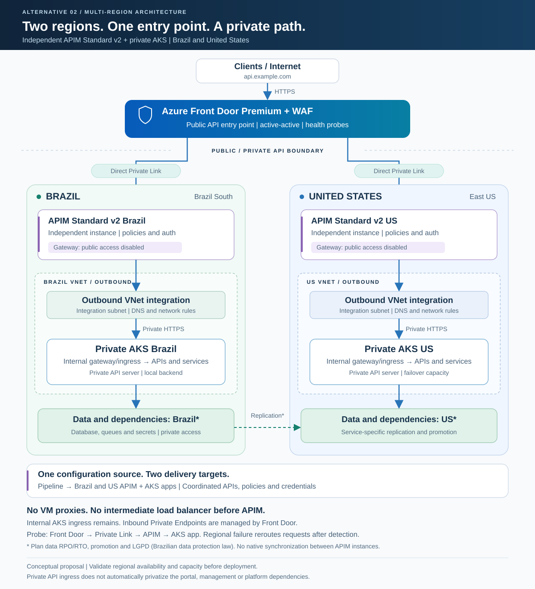

# Alternativa 2: arquitetura privada multi-região com dois APIM Standard v2

## 1. Objetivo e escopo

### Implementação de PoC com azd

O [projeto de IaC e guia operacional](../../README.md) implementa esta alternativa com duas instâncias Standard v2 e dois AKS novos. A PoC utiliza **HTTP somente no salto privado APIM → AKS** e uma API sintética sem autenticação de consumidor ou banco. O desenho de referência mantém HTTPS como objetivo de produção; essas concessões não devem ser levadas para produção.

APIM Developer não é uma substituição compatível nesta topologia. O guia explica a limitação e o processo de bootstrap privado.

Disponibilizar APIs em dois clusters Azure Kubernetes Service (AKS), um em **Brazil South** e outro em **East US**, mantendo somente o **Azure Front Door Premium com WAF** como entrada pública de APIs.

A solução utiliza **duas instâncias independentes de Azure API Management Standard v2**, uma por região:

- Entrada privada do Front Door diretamente no gateway de cada APIM via Private Link.
- Acesso público ao gateway desabilitado em ambas as instâncias.
- Integração de VNet de saída em cada APIM para alcançar o ingresso privado do AKS local.
- Failover e distribuição de tráfego realizados pelo Front Door.

**Não são necessários proxies em VMs, VM Scale Sets, Private Link Services próprios ou Load Balancers intermediários entre Front Door e APIM.** O ingresso privado das aplicações no AKS continua necessário e pode utilizar um Load Balancer interno, conforme a implementação escolhida.

> Proposta conceitual, não implantada. Confirmar a disponibilidade de Standard v2, Private Link, capacidade e demais recursos nas regiões e na assinatura escolhidas. O isolamento descrito é do tráfego de APIs; não representa garantia de isolamento de todos os endpoints de gestão ou ausência de comunicação com serviços públicos da plataforma.

## 2. Componentes

| Componente | Quantidade | Função |
|---|---|---|
| Azure Front Door Premium + WAF | Um perfil global | Entrada pública, proteção, origens privadas e seleção de região saudável. |
| APIM Standard v2 | Duas instâncias independentes | Gestão e execução das políticas das APIs, uma instância em cada região. |
| Conexões Private Link do Front Door | Uma conexão aprovada por origem regional | Acesso privado direto ao gateway APIM; Private Endpoints gerenciados pelo Front Door. |
| VNet e subnet de integração de saída | Uma configuração regional por APIM | Conectividade do APIM aos backends privados, com os requisitos de delegação do serviço. |
| AKS privado | Dois clusters | Executar as aplicações com API server privado e entrada de aplicação privada. |
| Gateway/Ingress privado do AKS | Uma implantação por cluster | Receber chamadas do APIM e encaminhar aos serviços Kubernetes. |
| Dados e dependências | Conforme a aplicação | Persistência, mensageria, armazenamento e segredos com recuperação própria. |
| Pipeline de entrega | Uma automação comum, com destinos regionais | Manter APIs, políticas e aplicações consistentes entre as regiões. |

O Front Door não é implantado dentro das VNets do cliente. Seus Private Endpoints de origem são gerenciados pelo serviço.

## 3. Desenho da arquitetura

### Diagrama em SVG



[Abrir o desenho em SVG](./arquitetura-alternativa-2-privada.svg)

O SVG pode ser aberto diretamente no navegador e não depende de extensões Mermaid ou draw.io.

### Versão em texto

O desenho em texto não depende de extensões Mermaid ou draw.io.

```text
                         Clientes / Internet
                                 |
                              HTTPS
                                 |
                                 v
                 +--------------------------------+
                 | Azure Front Door Premium + WAF |
                 | UNICA ENTRADA PUBLICA DE APIs   |
                 | Duas origens e health probes   |
                 +---------------+----------------+
                                 |
                    +------------+------------+
                    |                         |
               Private Link              Private Link
                    |                         |
                    v                         v
     +----------------------------+  +----------------------------+
     | BRASIL - Brazil South      |  | EUA - East US              |
     |                            |  |                            |
     | APIM Standard v2 Brasil    |  | APIM Standard v2 EUA       |
     | Gateway: acesso publico OFF|  | Gateway: acesso publico OFF|
     | Instancia independente     |  | Instancia independente     |
     |              |             |  |              |             |
     | Integracao de VNet de saida|  | Integracao de VNet de saida|
     |              |             |  |              |             |
     |         HTTPS privado      |  |         HTTPS privado      |
     |              v             |  |              v             |
     | AKS privado Brasil         |  | AKS privado EUA            |
     | Gateway/Ingress interno    |  | Gateway/Ingress interno    |
     |              |             |  |              |             |
     |              v             |  |              v             |
     | APIs / servicos            |  | APIs / servicos            |
     |              |             |  |              |             |
     |              v             |  |              v             |
     | Dados e dependencias*      |  | Dados e dependencias*      |
     +----------------------------+  +----------------------------+
                    |                         ^
                    + - - Replicacao* - - - - +

     Pipeline comum ---> APIM Brasil e APIM EUA
                      -> Aplicacoes nos dois clusters
```

**Legenda:** setas contínuas representam requisições e acesso às dependências. A replicação indicada por `*` depende do serviço de dados escolhido e não é realizada pelo APIM ou pelo AKS.

Os blocos regionais agrupam recursos por localização; não significam que toda a infraestrutura gerenciada do APIM Standard v2 reside na VNet do cliente. Nesta opção utiliza-se **integração de VNet de saída**, e não injeção do APIM clássico em VNet interna.

## 4. Fluxo normal das requisições

1. O cliente acessa `api.example.com`, apontado para o Front Door.
2. O WAF avalia a chamada.
3. O Front Door escolhe uma origem saudável conforme prioridades, pesos e regras de latência configurados.
4. A chamada chega ao gateway APIM escolhido por Private Link.
5. O APIM aplica autenticação, autorização, políticas e seleção do backend.
6. Pela integração de VNet de saída, o APIM acessa o ingresso privado do AKS da mesma região.
7. A aplicação consulta suas dependências.
8. A resposta retorna pelo APIM e pelo Front Door ao cliente.

Cada APIM deve ter seu backend configurado para o **AKS local**. Não é necessário usar `context.Deployment.Region` para distinguir gateways de uma mesma instância multi-região: os destinos são configurados separadamente nas duas instâncias.

## 5. Entrada privada: Front Door até o APIM

### Configuração por região

1. Criar a instância APIM Standard v2 regional.
2. Cadastrar uma origem APIM no Front Door Premium com Private Link habilitado para o gateway.
3. Aprovar no APIM a conexão de Private Endpoint solicitada pelo Front Door autorizado.
4. Configurar hostname de origem, origin host header e validação de certificado TLS conforme o hostname do APIM.
5. Validar o tráfego pela conexão privada.
6. Desabilitar **Public network access** no gateway da instância APIM.
7. Confirmar que chamadas diretas pela internet ao hostname do gateway não conseguem consumir as APIs.
8. Repetir para a segunda região.

No Standard v2, a documentação descreve a desativação em **Network > Edit > Inbound features > Public network access > Disable**. Confirmar os nomes atuais no portal.

> A integração de VNet de saída, isoladamente, não privatiza a entrada. O requisito depende da combinação de Private Link de entrada, conexão aprovada e acesso público desabilitado.

### Cuidados

- Utilizar **Front Door Premium**: a capacidade Private Link para origens não está disponível no Front Door Standard.
- Configurar duas origens realmente independentes, uma para cada instância APIM.
- Não usar o gateway público como fallback.
- Verificar suporte regional e localização dos Private Endpoints gerenciados pelo Front Door.
- Não concentrar inadvertidamente as duas conexões em um único domínio regional de falha; avaliar essa dependência quando a localização do Private Link diferir da localização da origem.
- Não criar Private Link Service próprio ou proxies para essa conexão direta.
- Um Private Endpoint adicional na VNet do cliente só é necessário se houver outro consumidor privado que precise dele; não é o endpoint gerenciado do Front Door.

## 6. Saída privada: APIM até o AKS

Em cada região:

- Integrar a instância APIM Standard v2 a uma VNet de saída na mesma região e assinatura, conforme os requisitos do serviço.
- Utilizar uma subnet dedicada e delegada conforme a documentação de integração.
- Configurar um backend com hostname resolvido para o endereço privado do Gateway/Ingress do AKS.
- Garantir conectividade, resolução DNS e regras NSG entre a subnet de integração e o ingresso privado.
- Validar TLS do backend: hostname, SNI, cadeia de confiança e certificados.
- Restringir a entrada de aplicação do AKS ao caminho autorizado do APIM.
- Manter o API server do cluster privado e sem administração pública.
- Usar agentes de entrega e ferramentas administrativas com acesso à rede privada.

**Integração de saída não equivale a uma NIC dedicada controlável pelo cliente para todo o APIM.** Regras NSG de entrada na subnet de integração não são o mecanismo para bloquear a entrada pública do gateway; utilizar o controle de acesso público e Private Link.

Não é necessário peering Brasil–EUA para o fluxo regional APIM → AKS. Conectividade entre regiões deve ser definida apenas quando exigida por dados, operação ou outros serviços.

## 7. Failover e verificações de saúde

O modelo proposto é **ativo-ativo na camada de APIs**. Para preferência pelo Brasil e contingência nos EUA, podem ser configuradas prioridades distintas no Front Door, sem alterar a conectividade privada.

### Probe ponta a ponta

A probe deve seguir o caminho:

```text
Front Door -> Private Link -> APIM regional -> AKS local -> endpoint de readiness
```

- Criar uma rota como `/health/ready`, encaminhada pelo APIM para a aplicação.
- Não responder à probe diretamente com sucesso estático no APIM.
- Não utilizar cache que oculte indisponibilidade da aplicação.
- Testar dependências críticas com verificações leves e tempo limite.
- Configurar o método HTTP da probe e implementar seu suporte.
- Definir como a probe será autorizada, sem divulgar segredos nem detalhes sensíveis.
- Ajustar frequência e limiares para equilibrar detecção de falhas e estabilidade.
- Definir readiness conforme a capacidade real da aplicação, inclusive escrita quando necessária.

### Cenários de falha

| Falha | Comportamento esperado | Pré-requisito |
|---|---|---|
| Brasil indisponível | Front Door deixa de selecionar a origem brasileira após a detecção e encaminha novas chamadas aos EUA. | EUA com APIM, AKS, dados e capacidade disponíveis. |
| EUA indisponível | Brasil continua atendendo. | Brasil dimensionado para a carga necessária. |
| AKS indisponível, APIM saudável | Probe falha e permite retirar a origem regional. | Probe realmente alcança a aplicação local. |
| APIM de uma região indisponível | A outra instância continua operando de forma independente. | Conexão privada e configurações da instância saudável disponíveis. |
| Banco primário indisponível | Continuidade depende da recuperação do banco, não somente do Front Door. | Replicação, promoção e configuração da aplicação definidas. |
| As duas origens não saudáveis | Não há garantia de continuidade; o Front Door possui comportamento próprio para todas as origens não saudáveis. | Testar esse cenário e não tratar probes como bloqueio absoluto. |
| Pipeline de entrega indisponível | As versões já implantadas podem continuar atendendo. | O caminho de requisições não depender sincronamente do pipeline. |

Failover não é instantâneo e chamadas em andamento podem falhar. Definir retentativas limitadas e idempotência para não duplicar operações de negócio.

O retorno do tráfego à região recuperada deve considerar saúde, capacidade e consistência dos dados. Failback de tráfego não substitui failback de banco de dados.

## 8. Duas instâncias: sincronização e gestão

Esta alternativa **não é o multi-região nativo de uma única instância APIM**. O Standard v2 é utilizado em duas implantações regionais independentes.

Cada instância possui configuração e gestão próprias. Não há sincronização automática entre elas para:

- APIs, versões, revisões e operações.
- Políticas em escopo global, produto, API e operação.
- Produtos, assinaturas de consumo e credenciais.
- Backends e Named Values.
- Certificados, identidades e permissões.
- Configuração do portal do desenvolvedor, caso utilizado.

### Estratégia recomendada

- Manter definições declarativas e políticas em uma fonte comum versionada.
- Executar validações e publicar por pipeline nas duas instâncias.
- Parametrizar somente diferenças regionais: hostname do backend, identidade, referências de segredos e recursos locais.
- Não pressupor que IDs de identidades gerenciadas serão iguais entre as instâncias.
- Provisionar permissões e acesso às dependências para cada identidade.
- Planejar o ciclo de vida das subscription keys se forem usadas: chaves diferentes sem provisionamento coordenado podem provocar erros após o desvio de tráfego.
- Se usar tokens OAuth/JWT, manter emissores, audiências e regras de validação consistentes nas duas instâncias.
- Não armazenar segredos em código ou no documento.
- Implantar de forma progressiva e validar cada região para reduzir falhas simultâneas por configuração.

Limites de chamadas e outros estados de runtime são independentes entre as instâncias. Não presumir rate limit global, cache compartilhado ou sessão sincronizada.

## 9. Dados, capacidade e conformidade

A aplicação pode estar ativa nas duas regiões sem que o banco aceite escrita simultânea. Para cada dependência, definir:

- Topologia: ativo-ativo, ativo-passivo ou recuperação por backup.
- Replicação, consistência e eventual perda de dados.
- Promoção automática ou manual e descoberta do novo primário.
- **RPO:** perda máxima aceitável de dados, medida em tempo.
- **RTO:** tempo máximo aceitável para recuperação.
- Processo de failback.
- Acesso privado e desativação de acesso público, quando suportados.
- Restrições de transferência internacional e requisitos de LGPD.

Uma réplica somente leitura nos EUA não garante continuidade de operações de escrita. Pode ser necessária promoção antes de a aplicação ficar pronta.

Dimensionar cada APIM, cluster e dependência para suportar a carga de contingência. Não depender apenas de autoscaling durante um incidente; validar quotas e tempo de provisionamento.

Monitorar disponibilidade, erros, latência, capacidade, conexões privadas e divergências de configuração. Distribuir recursos entre zonas quando o serviço, SKU e região suportarem.

## 10. Limites do requisito de privacidade

O compromisso desta arquitetura é: **somente o Front Door recebe tráfego público das APIs de negócio**.

Private Link de entrada no APIM está associado ao gateway. Ele não deve ser interpretado como privatização automática do portal do desenvolvedor, dos endpoints de gestão ou do Azure Resource Manager.

- Se o portal não for necessário, não publicá-lo; definir seu tratamento conforme as capacidades do serviço.
- Validar separadamente qualquer exigência de gestão exclusivamente privada.
- Controlar identidades, RBAC e acessos administrativos.
- Preservar as dependências de saída exigidas pelo serviço.
- Se a política proibir também qualquer endpoint público de gestão ou comunicação pública de plataforma, realizar uma análise adicional antes de aprovar a solução.

## 11. Comparação com a alternativa 1

| Aspecto | Alternativa 1 | Alternativa 2 |
|---|---|---|
| APIM | Uma instância Premium clássico com gateways regionais | Duas instâncias Standard v2 independentes |
| Entrada no APIM | Private Link Service, LB interno e proxies | Private Link direto do Front Door |
| Proxies em VMs | Necessários no desenho anterior | Não necessários |
| Balanceador intermediário antes do APIM | Necessário no desenho anterior | Não necessário |
| Acesso APIM → AKS | VNet interna do APIM clássico | Integração de VNet de saída |
| Replicação de configuração APIM | Nativa entre gateways da mesma instância | Pipeline e provisionamento coordenado |
| Gestão do APIM | Região primária da instância | Gestão própria por instância |
| Seleção de origem e failover | Front Door | Front Door |
| Recuperação de dados | Exige estratégia própria | Exige estratégia própria |
| Custos | Premium clássico e camada intermediária | Dois Standard v2 e recursos associados |

Menos componentes não garante menor custo total. Comparar capacidade, recursos necessários, tráfego, Private Link e esforço operacional sem pressupor uma economia percentual.

Documento da primeira alternativa: [Arquitetura com APIM Premium clássico interno e proxies](../arquitetura-1/arquitetura-multi-regiao-aks-apim.md).

## 12. Sequência de implantação e critérios de aceite

1. Confirmar regiões, disponibilidade dos recursos, quotas, requisitos de dados e metas de recuperação.
2. Provisionar as redes e os clusters AKS privados.
3. Implantar e validar as aplicações pelos ingressos internos.
4. Criar os dois APIM Standard v2 e configurar a integração de saída.
5. Publicar APIs e políticas por pipeline e testar o backend privado de cada instância.
6. Configurar Front Door Premium, WAF, domínio e duas origens Private Link.
7. Aprovar as conexões, testar o tráfego privado e desabilitar o acesso público aos gateways.
8. Configurar e validar probes ponta a ponta.
9. Executar testes de falha, capacidade e recuperação de dados.
10. Medir RTO/RPO e registrar os procedimentos de operação e failback.

| Teste | Critério de aceite |
|---|---|
| Consumo normal | APIs funcionam pelo domínio do Front Door com autenticação válida. |
| Acesso direto ao APIM pela internet | Chamadas não conseguem consumir as APIs em nenhuma das duas instâncias. |
| Acesso direto ao AKS pela internet | Ingressos e API servers privados não estão acessíveis publicamente. |
| Conectividade regional | Cada APIM alcança o ingresso privado do AKS local, com TLS validado. |
| Origem privada | Conexões Private Link corretas e aprovadas; não há fallback público. |
| Falha de backend | Remover a saúde da aplicação local faz a probe ponta a ponta falhar. |
| Failover regional | Novas chamadas passam a ser atendidas pela região saudável dentro da meta acordada. |
| Autenticação após failover | Tokens e/ou subscription keys continuam válidos na região sobrevivente conforme o desenho. |
| Capacidade | Região sobrevivente suporta a carga de contingência dentro dos limites definidos. |
| Dados e failback | Escrita, consistência, RPO/RTO e retorno são comprovados por testes. |
| Configuração | Pipeline entrega a mesma versão funcional, com parâmetros locais corretos, em ambas as instâncias. |

Esses testes são critérios propostos, não resultados já executados.

## 13. Referências oficiais

- [Front Door Premium com origem APIM via Private Link](https://learn.microsoft.com/en-us/azure/frontdoor/standard-premium/how-to-enable-private-link-apim)
- [Private Endpoints no APIM e desativação de acesso público](https://learn.microsoft.com/en-us/azure/api-management/private-endpoint)
- [Integração de VNet de saída no APIM Standard v2](https://learn.microsoft.com/en-us/azure/api-management/integrate-vnet-outbound)
- [Health probes do Azure Front Door](https://learn.microsoft.com/en-us/azure/frontdoor/health-probes)
- [Private Link para origens do Front Door](https://learn.microsoft.com/en-us/azure/frontdoor/private-link)
